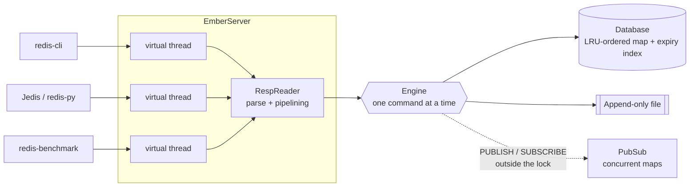

# EmberDB: a Redis-compatible database in Java

[](https://github.com/pMag11-alt/emberdb/actions/workflows/ci.yml)


EmberDB is an in-memory key-value database written from scratch in Java 21. It speaks the Redis wire protocol, both
RESP2 and RESP3, so unmodified Redis tools and client libraries work with it. The official `redis-cli`,
`redis-benchmark`, redis-py 8 and Jedis 5 are all tested against it.

It implements **116 Redis commands** across strings, lists, hashes, sets and sorted sets, with key expiry,
MULTI/EXEC transactions with WATCH, pub/sub, append-only-file persistence with crash recovery, and LRU eviction.
That is about 4,000 lines of Java, with no runtime dependencies.

```console
$ java -jar target/emberdb.jar
22:37:38.945 * EmberDB 1.0.0 starting (Java 21.0.4+7-LTS, pid 74226)
22:37:39.002 * Ready to accept connections on 127.0.0.1:6379

$ redis-cli                                   # the real Redis client
127.0.0.1:6379> ZADD leaderboard 100 alice 250 bob 175 carol
(integer) 3
127.0.0.1:6379> ZREVRANGE leaderboard 0 1 WITHSCORES
1) "bob"
2) "250"
3) "carol"
4) "175"
127.0.0.1:6379> SET session:42 "user=ada" EX 3600
OK
127.0.0.1:6379> TTL session:42
(integer) 3600
127.0.0.1:6379> LPUSH session:42 oops
(error) WRONGTYPE Operation against a key holding the wrong kind of value
```

## Features

- **Five data types**: strings (binary-safe), lists, hashes, sets and sorted sets, with the same semantics and
  error messages as Redis
- **Sorted sets on a skip list with spans**: ZRANK, ZRANGE, ZCOUNT and range queries all run in O(log n)
- **Key expiry, done the way Redis does it**: lazily when a key is read, plus a background job that samples
  random keys ten times a second
- **Persistence**: an append-only file with `always`, `everysec` or `no` fsync policies. After a crash it recovers
  from a half-written tail, and `BGREWRITEAOF` compacts it with an atomic rename
- **Transactions**: MULTI / EXEC / DISCARD, and WATCH for optimistic locking
- **Pub/sub**: SUBSCRIBE, PUBLISH, and PSUBSCRIBE with glob patterns
- **LRU eviction**: with `--maxkeys N`, the least recently used key is evicted in O(1)
- **RESP2 and RESP3**: after `HELLO 3`, a connection gets real maps, sets, doubles and push messages, byte for
  byte what Redis 8 sends. redis-py 8 uses RESP3 by default
- **Security and clients**: AUTH with a constant-time password check, HELLO, CLIENT, INFO, CONFIG GET
- **Concurrency**: one virtual thread per connection, and pipelined replies are batched into a few socket writes

## Quick start

You need Java 21 or newer. The Maven wrapper downloads Maven on first use.

```bash
git clone https://github.com/pMag11-alt/emberdb.git
cd emberdb
./mvnw package                  # compiles, runs the 129 tests, builds target/emberdb.jar
java -jar target/emberdb.jar    # listens on 127.0.0.1:6379
```

Connect with `redis-cli` (`brew install redis` / `apt install redis-tools`), any Redis client library, or plain
`nc localhost 6379`, since inline commands such as `PING` work too.

```text
java -jar target/emberdb.jar [options]

  --port <n>              TCP port (default 6379, 0 picks a free port)
  --bind <address>        interface to listen on (default 127.0.0.1)
  --requirepass <pass>    require AUTH <pass> before other commands
  --maxkeys <n>           evict least-recently-used keys beyond n keys (default 0 = unlimited)
  --appendonly yes|no     log writes to an append-only file and replay it on start (default no)
  --dir <path>            directory for the append-only file (default .)
  --appendfilename <name> append-only file name (default appendonly.aof)
  --appendfsync <policy>  always | everysec | no (default everysec)
```

## Benchmarks

These numbers come from `redis-benchmark` with 50 clients on an Apple M3 laptop. EmberDB ran on JDK 27 and the real
Redis 8 ran on the same machine with persistence off. Each figure is a single run of one benchmark, so read them as a
rough comparison, not a rigorous measurement.

| Requests per second | EmberDB | Redis 8.x |
|---------------------|--------:|----------:|
| SET                 | 188,000 |   208,000 |
| GET                 | 192,000 |   214,000 |
| INCR                | 205,000 |   213,000 |
| LPUSH               | 203,000 |   209,000 |
| ZADD                | 197,000 |   208,000 |
| SET, pipelined ×16  | 1.91 M  |   1.46 M  |
| GET, pipelined ×16  | 2.02 M  |   1.81 M  |

Reproduce them with `redis-benchmark -q -n 300000 -t set,get,incr,lpush,zadd` and add `-P 16` for the pipelined
rows. Without pipelining, both servers spend most of their time on network round trips. With pipelining, EmberDB
flushes replies only once the read buffer is empty, so a batch of 16 commands gets its 16 replies in one write.

## How it works



```
src/main/java/dev/emberdb/
├── EmberServer.java          TCP accept loop, one virtual thread per connection
├── Config.java               command-line flags (named like redis.conf options)
├── protocol/                 RespReader (commands in), RespWriter (RESP2/RESP3 out), Reply (sealed type)
├── engine/                   Engine (dispatch, locking, MULTI/WATCH, AOF propagation), Session, PubSub
├── commands/                 one class per command family: String, List, Hash, Set, SortedSet, Key, Server…
├── store/                    Database, SkipList, ListValue (ring buffer), ExpiryIndex, value types
├── persistence/              AppendOnlyFile, AofLoader (crash recovery), AofRewriter (compaction)
└── util/                     Glob (KEYS / PSUBSCRIBE patterns), Numbers (Redis-strict parsing)
```

### Design decisions

**Concurrency: parallel I/O, serial execution.** Each connection gets a Java 21 virtual thread, so 10,000 idle
clients cost almost nothing. Commands, though, run one at a time under a single lock, the same model as Redis's main
thread. That makes every command atomic (INCR from many clients never loses an update, and a test checks exactly
that), and it means the data structures need no locks of their own. The locks are `ReentrantLock`s, not
`synchronized`, because on Java 21 a virtual thread that blocks inside `synchronized` pins its carrier thread.
Pub/sub runs outside the lock on concurrent maps, so a PUBLISH that writes to many sockets never holds up other
clients.

**Sorted sets: a skip list with spans.** A sorted set pairs a `HashMap` (member to score, for O(1) ZSCORE) with a
skip list ordered by (score, member), following Redis's `t_zset.c`. Each forward pointer also stores its *span*,
the number of nodes it skips. Summing spans on the way down gives a node's rank in O(log n), so ZRANK and
`ZRANGE key 1000 1010` don't have to walk the list. A randomized test checks the skip list against a `TreeSet` over
20,000 inserts and deletes.

**Lists: a ring buffer.** `ListValue` is a power-of-two circular array. LPUSH, RPUSH, LPOP and RPOP are O(1), and
unlike `ArrayDeque` it supports O(1) LINDEX.

**Expiry: lazy plus sampled.** A key past its deadline is deleted when a command touches it. A background job also
runs Redis's active-expiry loop ten times a second: it samples 20 random keys that have a TTL, deletes the expired
ones, and repeats while more than 25% of the sample had expired. `ExpiryIndex` keeps keys in a dense array plus an
index map, so picking a random key and removing one are both O(1).

**LRU eviction in O(1).** The keyspace is a `LinkedHashMap` in *access order*, so its first entry is always the
least recently used key. With `--maxkeys` set, inserting a new key evicts from the head.

**Persistence: log what happened, not what was asked.** Every write command is appended to the AOF in RESP format,
but only if it changed something (each mutation bumps a dirty counter). Commands that depend on when or how they ran
are rewritten first, the way Redis does it:

| Client sent             | Logged as                       | Why                                              |
|-------------------------|---------------------------------|--------------------------------------------------|
| `EXPIRE k 60`           | `PEXPIREAT k 1761234567890`     | replaying tomorrow must not grant a fresh 60 s   |
| `SET k v EX 60`         | `SET k v PXAT 1761234567890`    | same                                             |
| `SPOP s 2`              | `SREM s <the two members>`      | replay would pick different random members       |
| `INCRBYFLOAT k 0.1`     | `SET k 10.6 KEEPTTL`            | no floating-point drift across replays           |
| `MULTI … EXEC`          | `MULTI … EXEC`                  | a crash must not replay half a transaction       |
| an LRU eviction         | `DEL k`                         | replay must end with the same keys               |

On startup, the loader replays the file. If the server died mid-write, the file ends in a partial command or in a
MULTI with no EXEC. The loader drops that tail and truncates the file, as Redis does with `aof-load-truncated yes`.
`BGREWRITEAOF` writes the smallest command list that recreates the dataset to a temp file, fsyncs it and renames it
over the old one atomically, so a crash at any point leaves one complete file. In the tests, 500 INCRs plus 100 ZADDs
shrink from 17 KB to under 2 KB.

**Binary safety with plain Strings.** Keys and values are decoded as Latin-1, which maps every byte to exactly one
`char`. Arbitrary binary data therefore round-trips exactly, while the code still gets `String`'s hashing, equality
and `compareTo`, which on Latin-1 orders like `memcmp`, as Redis does.

**One reply model, two protocols.** Commands return a protocol-neutral `Reply`, a sealed interface. `RespWriter`
encodes it per connection. `HGETALL` returns a `Dict`, which RESP3 clients receive as a real map (`%`) and RESP2
clients as a flat array. `ZRANGE … WITHSCORES` returns `Pairs`, which RESP3 nests as `[[member, score], …]` with
true doubles. Pub/sub messages are `Push` frames, which lets a RESP3 connection keep running ordinary commands while
it is subscribed. The expected bytes in the tests were captured from a real Redis 8 server.

**Pipelining-aware flushing.** `RespReader` keeps its own buffer, so the connection loop can tell whether another
command is already waiting. Replies are flushed only when none is. That is why the pipelined benchmark numbers
are about 10× the plain ones.

## Supported commands

| Group        | Commands |
|--------------|----------|
| Strings      | GET SET (NX XX GET EX PX EXAT PXAT KEEPTTL) SETNX SETEX PSETEX GETSET GETDEL MGET MSET MSETNX INCR DECR INCRBY DECRBY INCRBYFLOAT APPEND STRLEN GETRANGE |
| Lists        | LPUSH RPUSH LPUSHX RPUSHX LPOP RPOP (with count) LLEN LINDEX LSET LRANGE LTRIM LREM |
| Hashes       | HSET HMSET HSETNX HGET HMGET HDEL HGETALL HKEYS HVALS HLEN HEXISTS HSTRLEN HINCRBY HINCRBYFLOAT |
| Sets         | SADD SREM SMEMBERS SISMEMBER SMISMEMBER SCARD SPOP SRANDMEMBER SINTER SUNION SDIFF SINTERSTORE SUNIONSTORE SDIFFSTORE |
| Sorted sets  | ZADD (NX XX GT LT CH INCR) ZINCRBY ZREM ZSCORE ZMSCORE ZCARD ZCOUNT ZRANK ZREVRANK ZRANGE ZREVRANGE ZRANGEBYSCORE ZREVRANGEBYSCORE ZPOPMIN ZPOPMAX |
| Keys & TTL   | DEL UNLINK EXISTS TYPE KEYS RENAME RENAMENX EXPIRE PEXPIRE EXPIREAT PEXPIREAT (NX XX GT LT) TTL PTTL EXPIRETIME PEXPIRETIME PERSIST |
| Transactions | MULTI EXEC DISCARD WATCH UNWATCH |
| Pub/sub      | SUBSCRIBE UNSUBSCRIBE PSUBSCRIBE PUNSUBSCRIBE PUBLISH PUBSUB (CHANNELS NUMSUB NUMPAT) |
| Connection   | PING ECHO AUTH HELLO QUIT SELECT CLIENT (SETNAME GETNAME ID LIST INFO SETINFO) |
| Server       | INFO DBSIZE FLUSHALL FLUSHDB TIME CONFIG GET COMMAND BGREWRITEAOF SHUTDOWN |

## Testing

```bash
./mvnw test
```

The 129 JUnit 5 tests cover:

- **Protocol**: pipelining, binary data, inline commands, values larger than the read buffer, commands that arrive
  one byte at a time, malformed input, and RESP3 encodings checked byte for byte against real Redis output
- **Commands**: every data type, including option combinations (`SET … NX GET`, `ZADD GT CH`, `EXPIRE … LT`), edge
  cases and Redis's exact error messages
- **Data structures**: randomized differential tests of the skip list against `TreeSet` and the ring buffer against
  `ArrayDeque`
- **Transactions and pub/sub**: WATCH aborts, queue-time vs run-time errors, pattern subscriptions, cleanup on
  disconnect
- **Persistence**: restart round-trips, absolute TTLs after downtime, truncated tails, half-written transactions,
  rewrite compaction, logged evictions
- **Over TCP**: 8 connections × 2,000 concurrent INCRs must total exactly 16,000

Tests use a manual clock, so TTL behaviour is checked without `sleep`. GitHub Actions also starts the real server
and checks it with real clients: [`scripts/smoke-test.sh`](scripts/smoke-test.sh) (redis-cli, including
`--pipe` mass insertion), [`scripts/redis_py_check.py`](scripts/redis_py_check.py) (redis-py over RESP2 and RESP3,
including WATCH and pub/sub) and `redis-benchmark`. It then restarts the server to check that the data persisted.

## Limitations and ideas for extension

EmberDB is a learning project, not a Redis replacement. Not implemented yet:

- Lua scripting (EVAL), streams, HyperLogLog, geo commands, client-side caching
- Blocking commands (BLPOP, BRPOP), which would need a wait queue per key
- SCAN cursors, which need Redis's reverse-binary iteration over a resizable hash table
- RDB snapshots, replication and cluster mode
- Memory-based `maxmemory`: eviction is by key count, because estimating JVM object sizes is unreliable

## License

[MIT](LICENSE)
